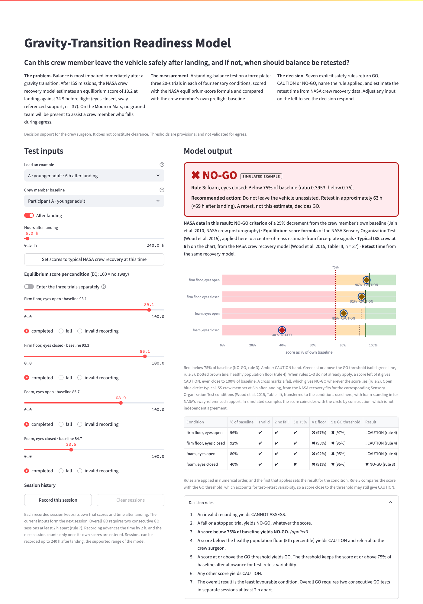

# Gravity-Transition Readiness Model

**Can an astronaut safely leave the vehicle after landing, and if not, when should balance be retested?**

The Gravity-Transition Readiness Model is a decision-support prototype developed for NASA Space Apps 2026, challenge *Create Health Monitoring Software for Astronauts on Space Missions*. It classifies a standing-balance test as **GO**, **CAUTION** or **NO-GO** (or **CANNOT ASSESS**), states the condition that determines the result, and estimates the retest time from NASA crew recovery data. The output supports the crew surgeon and does not constitute clearance.

Documentation: <https://vishram0905.github.io/gravity-readiness-docs/>



## Background
After International Space Station (ISS) missions, crew balance with eyes closed on a sway-referenced support (condition 5 of the NASA Sensory Organization Test) had a mean equilibrium score of **74.9 before flight**, and the fitted recovery model estimates **13.2 at landing** (95% limits ±21.1, n = 37 crew, Wood et al. 2015, Table III).

In a separate NASA study of 11 first-time astronauts tested 2–5 h after Space Shuttle missions, **20 of 22** eyes-closed laboratory balance trials with prescribed head movements on a sway-referenced support ended in a fall, compared with 3 of 22 with the head still (Jain et al. 2010).

NASA lists the *Risk of Altered Sensorimotor/Vestibular Function Impacting Critical Mission Tasks* among the risks of human spaceflight ([Human Research Roadmap](https://humanresearchroadmap.nasa.gov/risks/)). On the Moon or Mars, no ground team will be present to assist a crew member who falls while leaving the vehicle.

## Application
The application is an interactive model. The user sets the inputs of a balance test, and the decision engine returns the result immediately.
- **Test inputs:** the crew member's baseline (one of three participants of the Human Balance Evaluation Database, HBEDB, used as a preflight proxy), the time after landing, the equilibrium score in each of the four sensory conditions (one score, or the three trial scores whose median is used), the trial outcome in each condition (completed, fall or invalid recording), and a session history in which each recorded session keeps its own trial scores and time, so that the two-test rule is applied to recorded sessions. An example list fills every control with a recorded or simulated test and resets the pharmacological scenario to no dose (baseline day, 6 h after landing, the first GO session, the confirmatory session, and a baseline day with a simulated fall). A further control sets the scores to typical NASA crew recovery at the chosen time.
- **Model output:** a result card with the status (indicated by text and symbol, not colour alone), the number and text of the rule applied, and the recommended action; a statement of the NASA data used in the result; a chart placing each score against the NO-GO line, the healthy population floor, the GO threshold and, after landing, the typical ISS crew member at the same time (Wood et al. 2015, Table III); a table showing, for each condition, which rule is met; and the numbered decision rules with the applied rule marked. Sessions can be recorded up to 240 h after landing, the supported range of the model.
- **Recovery compared with typical NASA crew:** after landing, each recorded session and the current session are plotted against the NASA crew recovery curve of each condition (Wood et al. 2015, Table III), with the difference from the typical crew member at the latest session in percentage points of baseline. The comparison is descriptive and does not enter the decision.
- **Estimated retest time:** after landing, when the result is CAUTION or NO-GO, the time at which typical NASA crew recovery reaches every GO threshold, with its range and a statement of the condition that determines it.
- **From force plate to score:** the recorded centre-of-mass sway of the participant's baseline trial and the step-by-step computation of its equilibrium score.
- **Tabs:** a pharmacological scenario (promethazine, which adjusts only the retest estimate and is accompanied by warnings), NASA data and limitations, and additional crew data (NASA OSDR blood panels, context only).

## Decision rules
1. **Four sensory conditions are measured** (firm floor and foam, each with eyes open and closed, with three 20-s trials per condition). The score is the NASA equilibrium score, 100 × (1 − sway angle / 12.5°), computed from the centre of mass derived from force-plate data.
2. **Invalid or incomplete trials in a condition yield CANNOT ASSESS**, never GO. A condition that was not measured limits an otherwise GO result to CAUTION.
3. **Any fall yields NO-GO.** The median of the trials cannot mask a fall.
4. **A score below 75% of the individual's own baseline yields NO-GO.** Jain et al. (2010) regarded a decrement of less than 25% as recovery.
5. **A score below the healthy population floor (5th percentile) yields CAUTION** and referral. Otherwise, **GO is returned only if the ratio remains at or above 75% after allowance for test–retest variability**, and CAUTION is returned if it does not.
6. **An overall GO requires two consecutive measured GO tests in separate sessions at least 2 h apart.** The forecast estimates when to retest and never confers clearance.

The complete rules, assumptions and limitations are given in [ASSUMPTIONS.md](ASSUMPTIONS.md).

## NASA data
| NASA data | Role in the model |
|---|---|
| Wood et al. (2015), Table III: preflight values, landing-day values and recovery time constants for the NASA balance test in 37 ISS crew ([doi](https://doi.org/10.3357/AMHP.EC07.2015), transcribed in [`params/wood2015_table3.csv`](params/wood2015_table3.csv)) | The retest forecast r(t) = 1 − D·e^(−t/τ) for each condition, with a range derived from the published 95% limits of the fitted parameters (not a 95% interval for an individual retest time), the calibration check, and the simulated post-landing sessions |
| Jain et al. (2010), NASA posturography after short flights ([doi](https://doi.org/10.3357/asem.2710.2010)) | The 75% NO-GO criterion, the 5th-percentile floor and the problem statement |
| NASA Human Research Roadmap ([risks](https://humanresearchroadmap.nasa.gov/risks/)) | Problem definition |
| **NASA Open Science Data Repository (OSDR), SpaceX Inspiration4 crew blood panels**: [OSD-569](https://osdr.nasa.gov/bio/repo/data/studies/OSD-569) (complete blood count) and [OSD-575](https://osdr.nasa.gov/bio/repo/data/studies/OSD-575) (comprehensive metabolic panel), seven analytes for 4 crew members at 7 time points, processed by [`scripts/make_osdr.py`](scripts/make_osdr.py) into [`data/osdr/inspiration4_labs.csv`](data/osdr/inspiration4_labs.csv) | Context tab 'Additional crew data', presenting each crew member's values relative to their own preflight mean, the same within-subject principle as the balance test. These data do not enter the decision |
| Shi et al. (2011) and Boyd et al. (2009) (NASA promethazine studies) | Warnings displayed when a dose is entered |

Every cited value, with page locator and link, is listed in [`params/nasa_sources.csv`](params/nasa_sources.csv).

## Other data
The **HBEDB** (163 adults, 1,930 force-plate trials, Santos and Duarte 2016, [PhysioNet](https://physionet.org/content/hbedb/1.0.0/), ODC-By 1.0) provides baselines, test–retest variability and population floors. Three of its participants form the demonstration set, and only their files are included (`data/demo/`). Licences are listed in [DATA_LICENCES.md](DATA_LICENCES.md).

## Validation
The following results are reported in [out/VALIDATION.md](out/VALIDATION.md).
- **Calibration.** Scored with the NASA method, healthy adults aged 25–55 years reach 94.1 (firm floor, eyes open) and 92.9 (eyes closed), compared with NASA crew preflight means of 94.3 and 89.9. On foam with eyes closed, the healthy median is 10.9 points above the NASA sway-referenced mean (85.8 vs 74.9). Cohorts and protocols differ, so this comparison does not establish equivalence.
- **Single test in healthy individuals** (cross-validated, n = 140): GO 42.9%, CAUTION 56.4%, NO-GO 0.7%. The rules favour a retest over a false clearance, particularly for older individuals on foam.
- **Automated tests.** The test suite checks every rule against an independent statement of the arithmetic (200,000 random inputs, including invalid ones), the exact thresholds, malformed inputs, the two-test history rules, the retest solver against a brute-force search, and the application itself.

## Limitations
- The participants are not astronauts, and each was recorded in a single session, so day-to-day test–retest variability is not measured.
- No public dataset labels individuals as fit to leave a vehicle, so the thresholds are provisional and have not been validated for egress.
- Post-landing sessions in the demonstration are **simulated** by scaling a participant's recorded trials onto the typical NASA crew recovery curve, and they are labelled as simulated on screen.
- The forecast uses the recovery rate of a typical crew member and does not represent the slower recovery phase over subsequent weeks. A retest time later than 240 h after landing is labelled as an extrapolation.
- The healthy reference group comprises HBEDB participants without a reported disability, excluding reported labyrinthitis. Other illnesses and medication are not excluded.
- A reliable preflight baseline requires familiarisation sessions, because balance scores improve with repeated testing (Jain et al. 2010). The familiarisation protocol is not specified here, and the single-session HBEDB recordings cannot establish it.
- Jain et al. (2010) report that foam testing was tried with one Shuttle crew on landing day and abandoned after the crew reported concern that it disrupted their postflight recovery. Tolerability of the test on landing day is unresolved.
- The effect of promethazine on balance is an unvalidated scenario. A dose is entered as planned at or after the test, so it adjusts only the retest estimate and never changes a test result.

## Scope
Most health-monitoring tools display vital signs. This prototype converts a measurement into a decision at a moment that NASA documents as hazardous: leaving the vehicle after landing. Blood pressure, heart rate and other vital signs are natural further modules, and the 'Additional crew data' tab already presents NASA OSDR crew blood panels relative to each individual's preflight values, as context.

## Installation and use
```
python3 -m venv .venv
.venv/bin/pip install -r requirements.txt
.venv/bin/streamlit run app.py
```
Tests: `.venv/bin/python -m pytest` (the demonstration data are sufficient, and tests that require the full database are skipped). To reproduce every reported value, download the database with `python scripts/fetch_data.py --dest data/hbedb`, set `HBEDB_DIR=data/hbedb`, install `requirements-dev.txt`, and run `scripts/derive_params.py`, `scripts/validate.py` and the full test suite. The OSDR subset is rebuilt with `python scripts/make_osdr.py`, which downloads the two released files. Setting `OSDR_I4_DIR` to their folder checks every value against them.

## AI use
AI was used to assist in collecting literature, writing code and refining language.

## Licence
Code: MIT ([LICENSE](LICENSE)). Data: see [DATA_LICENCES.md](DATA_LICENCES.md). Prototype only. Not a medical device. No NASA endorsement is implied.
