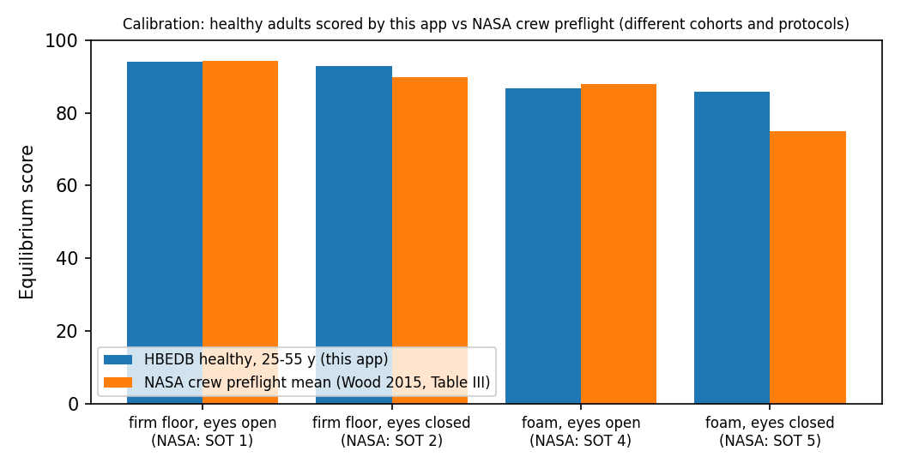
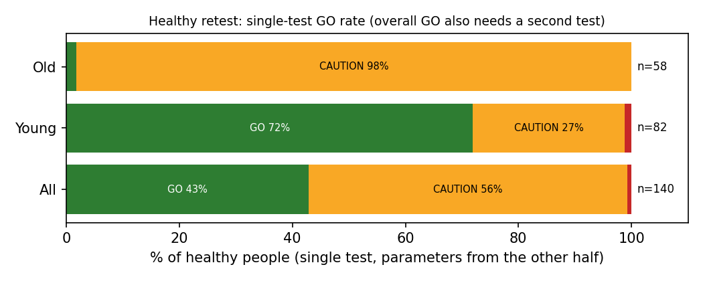

# Validation report

Generated by `scripts/validate.py` from the full Human Balance Evaluation Database (163 people, 1,930 trials). Seed 20261114. Limitation throughout: each HBEDB person was recorded in one session, so day-to-day retest noise is not measured, and no public dataset labels anyone as fit to leave a vehicle.

## 1. Calibration against NASA crew preflight (pre-registered)

Healthy adults aged 25-55 (n = 43); median of each person's median score, first 20-s window. NASA values are preflight means of 37 ISS crew (Wood 2015, Table III). Tolerance: within 5 points for the firm conditions (set before looking).

| Condition | NASA analogue | This app (median) | NASA preflight (mean) | Difference |
|---|---|---|---|---|
| firm floor, eyes open | SOT 1 | 94.1 | 94.3 | -0.2 |
| firm floor, eyes closed | SOT 2 | 92.9 | 89.9 | +3.0 |
| foam, eyes open | SOT 4 | 86.9 | 87.9 | -1.0 |
| foam, eyes closed | SOT 5 | 85.8 | 74.9 | +10.9 |

Firm conditions pass. On foam with eyes closed this app's healthy median is 10.9 points above NASA's SOT 5 mean. That is an observed difference between different cohorts, estimators and protocols (foam here; a sway-referenced platform at NASA), not a measured effect of the support surface. Agreement on the firm conditions does not establish equivalence with NASA's method.

## 2. Healthy retest (2-fold cross-validation by subject)

Parameters are fitted on one half of the healthy people and applied to the other half. Baseline = first 20-s windows; retest = second 20-s windows of the same trials (no impairment). Single test, so the two-test rule is not applied here.

- All (n = 140): GO 42.9%, CAUTION 56.4%, NO-GO 0.7%
- Young (n = 82): GO 72.0%, CAUTION 26.8%, NO-GO 1.2%
- Old (n = 58): GO 1.7%, CAUTION 98.3%, NO-GO 0.0%

Healthy people are often held at CAUTION, especially older people on foam under literature-level noise. This is the deliberate safety trade-off: the app prefers a retest to a false clearance.

## 3. Structural regression check (not evidence of safety)

Retest = 0.74 x each person's own baseline trials, so the ratio is exactly 0.74 in every condition (n = 140): GO 0.0%, CAUTION 0.0%, NO-GO 100.0%; the 75% ratio rule gave NO-GO in all four conditions for 140 of 140 people. This confirms the rule is wired; it is not evidence of safety.

## 4. Automated tests

`pytest` (full data, HBEDB and OSDR files present) at commit 35321e5: 196 passed in 49.05s. The count refers to that commit; later commits may add tests.

Separately, before the hackathon the frozen mathematical framework was checked by an independent test bench (826,569 checks, 0 failed); that is a historical check of the framework, not of this code. See ASSUMPTIONS.md.
